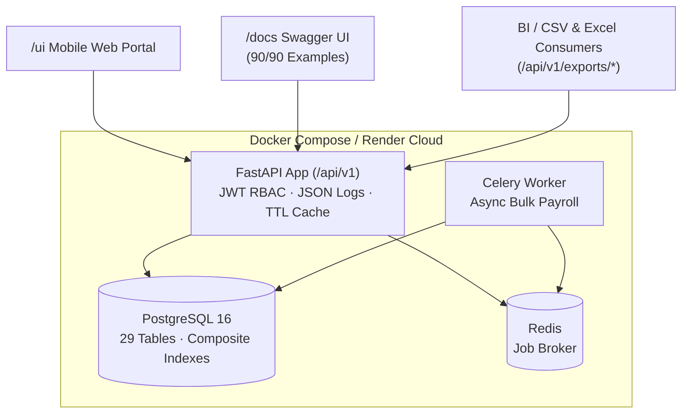

# LedgerForge API — HR, Payroll & Double-Entry Accounting Platform

**Candidate:** Ancilin P G (ID: `GM00210`) | **Track:** Python Developer | **Release:** [`v1.0.0`](https://github.com/Ancilin/Foundation-Project-Setup-Employee-Data-Model/releases/tag/v1.0.0)

**Key Handover Documents:** [`RELEASE_NOTES.md`](RELEASE_NOTES.md) · [`CHANGELOG.md`](CHANGELOG.md) · [`docs/architecture.md`](docs/architecture.md) · [`docs/DEMO_SCRIPT.md`](docs/DEMO_SCRIPT.md) · [`Python_Ancillin_Final_Consolidated_Report.pdf`](Python_Ancillin_Final_Consolidated_Report.pdf)
- **Live Production App:** <https://ledgerforge-ijqw.onrender.com>
- **5-Minute Live Demo Video:** <https://drive.google.com/file/d/1r71lqbsPnuN5xNPHircIQvE4ynPZ5qIg/view?usp=sharing>
- **Interactive API Docs (Swagger UI — 91/91 endpoints with real examples):** <https://ledgerforge-ijqw.onrender.com/docs>
- **Mobile-Friendly Web Portal (Login, Run Payroll, View & Download Payslips):** <https://ledgerforge-ijqw.onrender.com/ui>
- **Live Health Probe:** <https://ledgerforge-ijqw.onrender.com/health>

---

## What is LedgerForge?

LedgerForge is a production-ready **FastAPI + SQLAlchemy 2.0 + PostgreSQL + Celery/Redis** backend that unifies **Employee & Org Management**, **Attendance & Leave**, **Indian Statutory Payroll** (EPF, ESI, Professional Tax, New-Regime TDS), **Double-Entry General Ledger**, **Invoicing & Expense Bills**, **Financial Statements** (Trial Balance, P&L, Balance Sheet), **Background Jobs**, and **Streaming CSV / Excel Data Exports**.

Every calculation is mathematically verified against the official 18-month master dataset (**745 employees**, **150,156 attendance rows**, **7,340 payroll items**, **2,524 journal entries**):
- **Automated Tests:** `132 passed` (`pytest`, ~90% coverage)
- **Official Payroll Accuracy:** `7,340 / 7,340 = 100.00%` exact match (within 1 paisa)
- **Official Integrity Checks:** `5 / 5 checks passed` (zero unbalanced entries, zero payroll-to-ledger variance, zero payments after exit)
- **Trial Balance Accuracy:** `40 / 40` accounts exact match (`0` mismatched)
- **Backup & Restore Proof:** `193,036 / 193,036` rows across 29 tables restored with 100% parity
- **Final Challenge (Task 20):** Executive Departmental Payroll Cost Report (`GET /api/v1/reports/department-payroll-cost`) built on branch `feat/department-payroll-cost-report`

---

## Project Milestones (Phases 1–4)

| Phase | Days / Tasks | Key Capabilities | Tag | Report |
| :--- | :--- | :--- | :--- | :--- |
| **Phase 1: Foundation** | Days 1–5 (`LF-01`–`LF-05`) | FastAPI layered architecture, PostgreSQL + Docker, Alembic migrations, Employee/Org hierarchy, Master Seeder, Salary Structures & Revisions | `phase-1` | [`Python_Ancillin_Phase1_Report.pdf`](Python_Ancillin_Phase1_Report.pdf) |
| **Phase 2: Core Development** | Days 6–10 (`LF-06`–`LF-10`) | Attendance & Leave, Indian Gross-to-Net Payroll Engine, Payslip PDFs, Double-Entry Ledger, Client Invoices & Receivables | `phase-2` | [`Python_Ancillin_Phase2_Report.pdf`](Python_Ancillin_Phase2_Report.pdf) |
| **Phase 3: Connected System** | Days 11–15 (`LF-11`–`LF-15`) | Vendors & Expense Bills, 18-Run Payroll-to-Books, JWT RBAC (`ADMIN`/`HR`/`EMPLOYEE`), Configurable Tax Engine, Trial Balance / P&L / Balance Sheet | `phase-3` | [`Python_Ancillin_Phase3_Report.pdf`](Python_Ancillin_Phase3_Report.pdf) |
| **Phase 4: Production & Handover** | Days 16–20 (`LF-16`–`LF-20`) | Celery/Redis Background Jobs, `/api/v1`, CI/CD, Cloud Blueprint + `/ui`, EXPLAIN Indexing & TTL Cache, JSON Logs, DB Health Probe, Backup/Restore, Streaming CSV/Excel Exports, OpenAPI Examples, Final Challenge & `v1.0.0` Audit | `v1.0.0` | [`Python_Ancillin_Phase4_Report.pdf`](Python_Ancillin_Phase4_Report.pdf) · [`Final Report`](Python_Ancillin_Final_Consolidated_Report.pdf) |

---

## System Architecture

> See [`docs/architecture.md`](docs/architecture.md) for the full sequence diagram and domain layer breakdown.



Request flow follows a strict separation of concerns: **`Route → Service → SQLAlchemy ORM → Database`**. Routes never contain business logic; services never depend on HTTP objects.

---

## Quick Start (Zero Prior Context Needed)

### Prerequisites
- **Option A (Recommended — Fastest):** [Docker Desktop](https://www.docker.com/products/docker-desktop/) running locally
- **Option B (Local Python, no Docker):** Python **3.12+** and Git

---

### Option A: Run the Full Stack with Docker (3 Commands)

```bash
# 1. Clone the repository
git clone https://github.com/Ancilin/Foundation-Project-Setup-Employee-Data-Model.git
cd Foundation-Project-Setup-Employee-Data-Model

# 2. Create your local environment file (Windows PowerShell: Copy-Item .env.example .env)
cp .env.example .env
# Edit .env and set POSTGRES_PASSWORD and SECRET_KEY (any string >= 16 chars)

# 3. Start PostgreSQL, Redis, FastAPI API, and Celery Worker
docker compose up --build
```

In a second terminal, apply database migrations and load the seed dataset:
```bash
docker compose exec api alembic upgrade head
docker compose exec api python -m scripts.seed --reset
```

Open in your browser:
- Health Check: <http://localhost:8000/health>
- Swagger API Docs: <http://localhost:8000/docs>
- Web UI: <http://localhost:8000/ui>

Stop everything cleanly: `docker compose down` (add `-v` to wipe database volumes).

---

### Option B: Run Locally Without Docker (SQLite or Local PostgreSQL)

```bash
# 1. Clone and enter the repo
git clone https://github.com/Ancilin/Foundation-Project-Setup-Employee-Data-Model.git
cd Foundation-Project-Setup-Employee-Data-Model

# 2. Create & activate virtual environment
python -m venv .venv
# Windows PowerShell:
.venv\Scripts\Activate.ps1
# macOS / Linux:
# source .venv/bin/activate

# 3. Install dependencies
pip install -r requirements-dev.txt

# 4. Copy .env.example -> .env
#    Tip: For instant local setup without installing Postgres, set:
#    DATABASE_URL=sqlite:///./ledgerforge.db
#    SECRET_KEY=dev-super-secret-key-at-least-16-chars
cp .env.example .env

# 5. Apply migrations, seed the database, and start the server
alembic upgrade head
python -m scripts.seed --reset
uvicorn app.main:app --reload
```

---

### Option C: Deploy to the Cloud (Render Blueprint)

This repository includes [`render.yaml`](render.yaml) and [`start.sh`](start.sh):
1. Connect your fork of this GitHub repository in **Render → Blueprints**.
2. Render provisions a hosted PostgreSQL database and web service automatically from `render.yaml`.
3. `SECRET_KEY` and `DATABASE_URL` are injected via Render Environment Variables — **no secrets are ever committed to Git**.
4. On boot, `start.sh` automatically runs `alembic upgrade head`, seeds initial data if empty, and launches `uvicorn`.

---

## 10 Copy-Paste API Examples

> Set `BASE_URL` to either your local server (`http://localhost:8000`) or the live cloud URL (`https://foundation-project-setup-employee-data.onrender.com`).

```bash
export BASE_URL="http://localhost:8000"
```
*(In Windows PowerShell, replace `export BASE_URL=...` with `$BASE_URL = "http://localhost:8000"` and use `$TOKEN` instead of `$TOKEN` with `curl.exe`.)*

### 1. Check Live Health & Database Connectivity
```bash
curl -s "$BASE_URL/health"
```
Expected: `{"status":"ok","service":"ledgerforge-api","database":"connected","latency_ms":...}`

### 2. Authenticate as Admin & Save JWT Token
```bash
TOKEN=$(curl -s -X POST "$BASE_URL/api/v1/auth/login" \
  -H "Content-Type: application/json" \
  -d '{"username":"admin","password":"LedgerForge2025!"}' | python -c "import sys,json; print(json.load(sys.stdin)['access_token'])")
echo "Token acquired: ${TOKEN:0:24}..."
```
*(The `admin` shortcut maps to seeded admin account `sanjay.kumar@znova-demo.example`.)*

### 3. List Employees with Search & Pagination
```bash
curl -s "$BASE_URL/api/v1/employees?page=1&size=5&q=jatin" \
  -H "Authorization: Bearer $TOKEN"
```

### 4. View an Employee's Direct Reports (Org Hierarchy)
```bash
curl -s "$BASE_URL/api/v1/employees/EMP-0001/team" \
  -H "Authorization: Bearer $TOKEN"
```

### 5. Run a Live Gross-to-Net Payroll Calculation
```bash
curl -s -X POST "$BASE_URL/api/v1/payroll/calculate" \
  -H "Authorization: Bearer $TOKEN" \
  -H "Content-Type: application/json" \
  -d '{"employee_id":"EMP-0002","month":"2025-04","variable_pay":"0.00","other_deductions":"0.00"}'
```

### 6. Download an Official Employee Payslip PDF
```bash
curl -s -L "$BASE_URL/api/v1/payroll/runs/PR-2025-04/payslips/EMP-0002/pdf" \
  -H "Authorization: Bearer $TOKEN" \
  -o payslip_EMP-0002_2025-04.pdf
```

### 7. Fetch the Cached Trial Balance Report
```bash
curl -s "$BASE_URL/api/v1/reports/trial-balance" \
  -H "Authorization: Bearer $TOKEN"
```
*(First call computes via indexed double-entry SQL; subsequent calls serve from the TTL cache in ~0.01 ms.)*

### 8. Stream Payroll Items as CSV with Date Filters
```bash
curl -s "$BASE_URL/api/v1/exports/payroll?start_date=2025-04-01&end_date=2025-04-30" \
  -H "Authorization: Bearer $TOKEN" \
  -o payroll_2025_04.csv
```

### 9. Export Posted General Ledger Lines as an Excel (`.xlsx`) Workbook
```bash
curl -s "$BASE_URL/api/v1/exports/ledger?start_date=2025-04-01&end_date=2025-06-30&format=xlsx" \
  -H "Authorization: Bearer $TOKEN" \
  -o ledger_q1.xlsx
```

### 10. Incremental Delta Export (Only Changes Since a Timestamp)
```bash
curl -s "$BASE_URL/api/v1/exports/changes?since=2025-04-01T00:00:00" \
  -H "Authorization: Bearer $TOKEN"
```
Returns JSON counts and IDs of all employees, payroll items, and journal entries created or modified since the cutoff timestamp (and `?since=...` also works directly on `/exports/employees`, `/exports/payroll`, and `/exports/ledger`).

---

## Environment Variables Reference

All configuration is loaded via Pydantic Settings (`app/core/config.py`). See [`.env.example`](.env.example).

| Variable | Required | Default / Example | Description |
| :--- | :---: | :--- | :--- |
| `DATABASE_URL` | Yes | `postgresql+psycopg://ledgerforge:...@db:5432/ledgerforge` | SQLAlchemy DB connection URL (supports PostgreSQL or `sqlite:///./ledgerforge.db`) |
| `SECRET_KEY` | Yes | *(min 16 random chars)* | JWT HS256 signing secret — **never commit real keys** |
| `POSTGRES_USER` | Docker | `ledgerforge` | PostgreSQL username used by `docker-compose.yml` |
| `POSTGRES_PASSWORD` | Docker | *(set locally)* | PostgreSQL password used by `docker-compose.yml` |
| `POSTGRES_DB` | Docker | `ledgerforge` | PostgreSQL database name |
| `REDIS_URL` | Optional | `redis://redis:6379/0` | Celery broker & result backend (auto-falls back to local background thread if unset/unreachable) |
| `DEBUG` | Optional | `false` | Enables verbose FastAPI debug mode |
| `LOG_LEVEL` | Optional | `INFO` | Structured JSON log threshold (`DEBUG`, `INFO`, `WARNING`, `ERROR`) |

---

## Testing, Verification & Operations

```bash
# Run full automated test suite (128 tests, self-contained in-memory SQLite — no .env required)
pytest -q

# Run live smoke test suite against local or deployed URL
python scripts/smoke_test.py --url http://localhost:8000

# Verify exported payroll rows against the official dataset (7,340/7,340 = 100.00%)
python scripts/verify_ledgerforge.py payroll exports/task19_payroll_export.csv --data exports

# Run all 5 official accounting & payroll integrity checks
python scripts/verify_ledgerforge.py checks --data exports

# Run automated backup + restore into a fresh database + row-count parity check
python scripts/backup_restore.py
```

---

## Repository Layout

```text
Foundation-Project-Setup-Employee-Data-Model/
├── app/
│   ├── main.py              # FastAPI app factory, JSON logging middleware, OpenAPI enrichment
│   ├── api/routes/          # 15 versioned route modules (/api/v1/*) + /health + /ui
│   ├── core/                # config.py, security.py, logging.py, cache.py, openapi.py
│   ├── db/                  # SQLAlchemy 2.0 engine & session lifecycle
│   ├── models/              # 29 ORM models with CHECK constraints & composite indexes
│   ├── schemas/             # Pydantic v2 request/response schemas
│   └── services/            # Payroll, Ledger, Tax, Reports, Exports, Jobs, Auth services
├── migrations/              # Alembic migrations (0001 through 0011)
├── docs/                    # architecture.md (Mermaid), er-diagram.md, api-contract.md
├── scripts/                 # seed.py, verify_ledgerforge.py, smoke_test.py, backup_restore.py
├── exports/                 # Verified CSV exports & trial_balance.csv
├── tests/                   # 128 pytest unit & integration tests
├── .github/workflows/ci.yml # GitHub Actions CI pipeline
├── Dockerfile               # Production container image (zero secrets)
├── docker-compose.yml       # Local multi-service stack (api, db, redis, worker)
├── render.yaml              # Render cloud Infrastructure-as-Code blueprint
├── CHANGELOG.md             # Release notes (Keep a Changelog)
└── README.md                # You are here
```

---

## Troubleshooting & First-Time Onboarding FAQ

Issues discovered and fixed during fresh-clone walkthrough testing:

1. **PowerShell `cp .env.example .env` or `&&` errors on Windows:**
   - Windows PowerShell 5.1 does not support `&&` as a command separator — use `;` instead, and use `Copy-Item .env.example .env` if `cp` is aliased differently.
2. **PowerShell script execution policy blocks `.venv\Scripts\Activate.ps1`:**
   - Run `Set-ExecutionPolicy -Scope CurrentUser RemoteSigned`, or invoke `.venv\Scripts\python.exe` and `.venv\Scripts\pytest.exe` directly without activating.
3. **API fails on startup with `DATABASE_URL` or `SECRET_KEY` validation error:**
   - Ensure `.env` exists in the repository root and `SECRET_KEY` is at least 16 characters long. For quick local testing without PostgreSQL, set `DATABASE_URL=sqlite:///./ledgerforge.db`.
4. **First request to the live Render URL takes ~30–50 seconds:**
   - Render's free web tier spins down after 15 minutes of inactivity and wakes automatically on the first HTTP request. Subsequent requests respond in milliseconds.
5. **Login returns `401 Unauthorized`:**
   - Make sure the database was seeded (`python -m scripts.seed --reset`) and use `{"username": "admin", "password": "LedgerForge2025!"}` (or `sanjay.kumar@znova-demo.example`).
6. **Where do I see every endpoint and try them interactively?**
   - Open `/docs` (Swagger UI). All **90/90** endpoints include pre-filled realistic examples—click **Authorize**, paste your Bearer token from Example #2, and click **Try it out**.

---

## Release History

See [`CHANGELOG.md`](CHANGELOG.md) for the complete version-by-version changelog from `phase-1` through `v1.0.0-rc1`.
