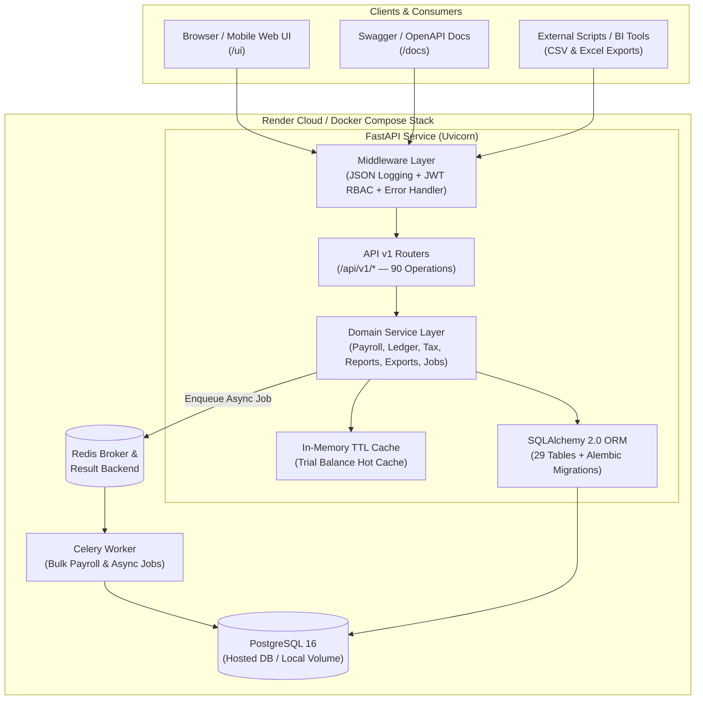
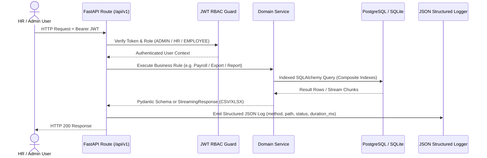

# LedgerForge System Architecture

This document illustrates the final production architecture of **LedgerForge** (Phases 1–4, `v1.0.0-rc1`), including client entry points, the layered FastAPI backend, asynchronous Celery/Redis workers, PostgreSQL storage, observability, and data export pipelines.

## 1. High-Level Deployment & Runtime Architecture

## 2. Layered Request & Data Flow

Every HTTP request follows a strict one-way layered architecture (`Route → Service → ORM/Database`) so business rules remain completely decoupled from HTTP transport concerns:

## 3. Core Domain Modules

| Layer | Directory | Responsibility |
| :--- | :--- | :--- |
| **HTTP Routes** | `app/api/routes/` | Request parsing, role guards, pagination, streaming responses (`employees`, `salaries`, `attendance`, `leave`, `payroll`, `ledger`, `invoices`, `expenses`, `tax`, `reports`, `jobs`, `exports`, `health`, `ui`) |
| **Business Services** | `app/services/` | Payroll engine, double-entry journal posting, Indian statutory tax engine (EPF/ESI/PT/TDS), financial reports + TTL cache, streaming CSV/Excel exports, background job orchestration |
| **ORM Models** | `app/models/` | 29 normalized tables with natural business keys, `CHECK` constraints, soft-delete flags (`is_active`), audit timestamps, and composite indexes |
| **Migrations** | `migrations/versions/` | Versioned Alembic migrations (`0001` through `0011`) for schema creation and performance indexing |
| **Core Infrastructure** | `app/core/` | Environment config (`config.py`), JWT/bcrypt security (`security.py`), structured JSON logs (`logging.py`), OpenAPI enrichment (`openapi.py`), report cache (`cache.py`) |
| **Operations & QA** | `scripts/` & `tests/` | Master dataset seeder, official verifier (`verify_ledgerforge.py`), backup/restore proof (`backup_restore.py`), live smoke tests (`smoke_test.py`), 128 automated pytest tests |
