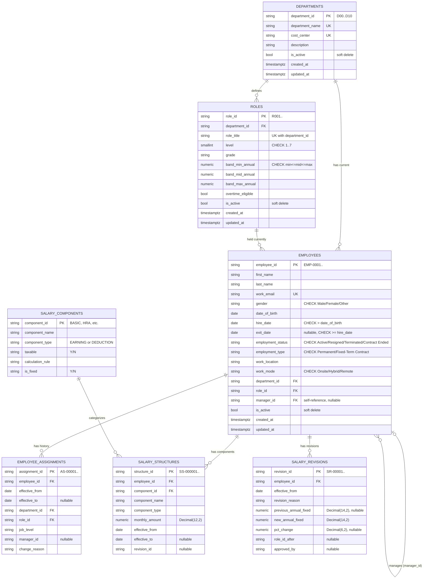

# ER Diagram – Employee, Department, Role & Salary Data Model

Source of truth: [`app/models/`](../app/models) and migrations.
Matches the official LedgerForge dataset schema (`departments`, `roles`, `employees`, `employee_assignments`, `salary_components`, `salary_structures`, `salary_revisions`).



## Relationships

| Relationship | Type | Delete behaviour |
|---|---|---|
| department → roles | one-to-many | blocked while roles exist (no cascade) |
| department → employees | one-to-many | blocked while employees exist |
| role → employees | one-to-many | blocked while employees hold it |
| employee → manager (employee) | many-to-one, **self-reference** | blocked while the manager has reports |
| employee → assignments | one-to-many | cascades on employee deletion |
| employee → salary structures | one-to-many | cascades on employee deletion |
| employee → salary revisions | one-to-many | cascades on employee deletion |

---

## Which Columns Can Be Empty and Why (Task 2 Requirement)

1. **`employees.exit_date`**: NULL for active employees who are currently employed; populated only when an employee resigns or is terminated.
2. **`employees.manager_id`**: NULL strictly for the company's executive head (e.g., CEO/Managing Director) who sits at the top of the reporting hierarchy and has no superior.
3. **`effective_to` (in assignments & salary structures)**: NULL for current, active records that remain in force today; populated with an end date only when superseded by a new revision or assignment.

---

## Temporal Query: "Who was in department D05 on 30 June 2025?"

To determine historical assignment at a specific point in time without relying solely on current mutable columns, query `employee_assignments`:

```sql
SELECT employee_id, role_id, manager_id, effective_from, effective_to
FROM employee_assignments
WHERE department_id = 'D05'
  AND effective_from <= '2025-06-30'
  AND (effective_to IS NULL OR effective_to >= '2025-06-30');
```

---

## Constraints

| Table | Constraint | Why |
|---|---|---|
| employees | `UNIQUE(work_email)` | one login/identity per person |
| employees | `CHECK exit_date IS NULL OR exit_date >= hire_date` | no leaving before joining |
| employees | `CHECK hire_date > date_of_birth` | sanity: employment cannot precede birth |
| employees | `CHECK manager_id IS NULL OR manager_id <> employee_id` | nobody manages themselves |
| employees | `CHECK` on gender / status / type / work mode | allowed values enforced at database level |
| roles | `UNIQUE(department_id, role_title)` | no duplicate titles within a department |
| roles | `CHECK level BETWEEN 1 AND 7`, band order | ensures valid compensation ladders |
| departments | `UNIQUE(department_name)`, `UNIQUE(cost_center)` | unique enterprise identifiers |

## Indexes (for Searching & Fast Joins)

| Index | Columns | Serves |
|---|---|---|
| `ix_employees_name` | `last_name, first_name` | name search / alphabetical directory |
| `ix_employees_department_id` | `department_id` | "all employees in department X" |
| `ix_employees_role_id` | `role_id` | "who holds role X" |
| `ix_employees_manager_id` | `manager_id` | "show my team" (hierarchy lookups) |
| `ix_employees_employment_status` | `employment_status` | active/leaver filters |
| `ix_assignments_employee_id` | `employee_id` | historical career progression lookups |
| `ix_assignments_effective_from` | `effective_from` | point-in-time organization audits |
| `ix_structures_employee_id` | `employee_id` | salary component breakdown queries |
| `ix_structures_effective_from` | `effective_from` | effective-dated compensation resolution |
| `ix_revisions_employee_id` | `employee_id` | appraisal & raise tracking |
