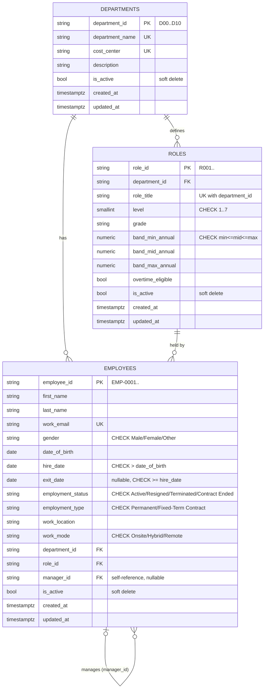

# ER Diagram – Employee, Department & Role data model

Source of truth: [`app/models/`](../app/models) and migration
[`0001_create_employee_tables.py`](../migrations/versions/0001_create_employee_tables.py).
Column names follow the `01_LedgerForge_Python_Master_Dataset` workbook (`employees`, `departments`, `roles` sheets).

## Relationships

| Relationship | Type | Delete behaviour |
|---|---|---|
| department → roles | one-to-many | blocked while roles exist (no cascade) |
| department → employees | one-to-many | blocked while employees exist |
| role → employees | one-to-many | blocked while employees hold it |
| employee → manager (employee) | many-to-one, **self-reference** | blocked while the manager has reports |

Nothing cascades: rows are never hard-deleted in normal use. Set `is_active = false` instead (soft delete),
so payroll, leave and reports can still resolve old IDs.

## Constraints

| Table | Constraint | Why |
|---|---|---|
| employees | `UNIQUE(work_email)` | one login/identity per person |
| employees | `CHECK exit_date IS NULL OR exit_date >= hire_date` | no leaving before joining |
| employees | `CHECK hire_date > date_of_birth` | sanity |
| employees | `CHECK manager_id IS NULL OR manager_id <> employee_id` | nobody manages themselves |
| employees | `CHECK` on gender / status / type / work mode | allowed values enforced by the DB |
| roles | `UNIQUE(department_id, role_title)` | no duplicate titles within a department |
| roles | `CHECK level BETWEEN 1 AND 7`, band order | matches dataset rules |
| departments | `UNIQUE(department_name)`, `UNIQUE(cost_center)` | |

## Indexes (for searching)

| Index | Columns | Serves |
|---|---|---|
| `ix_employees_name` | `last_name, first_name` | name search / sorted lists |
| `ix_employees_department_id` | `department_id` | "all employees in department X" |
| `ix_employees_role_id` | `role_id` | "who holds role X" |
| `ix_employees_manager_id` | `manager_id` | "show my team" (hierarchy lookups) |
| `ix_employees_employment_status` | `employment_status` | active/leaver filters |
| `ix_roles_department_id` | `department_id` | roles per department |
| (automatic) | `work_email` unique index | login / duplicate check |

## Known limits

- Cycles longer than one step (A manages B, B manages A) are not blocked by the database; the
  service layer in Task 3 must reject them when a manager is changed.
- Only the *current* role/manager/department is stored. Dataset sheets such as `employee_assignments`
  (history) are a later addition.
