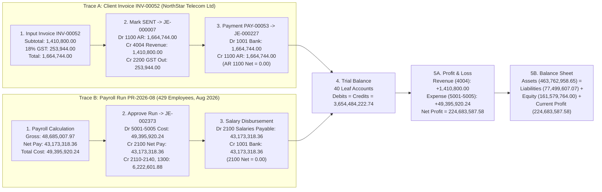

# LedgerForge — Phase 3 Report
**WorkforceOS: Connected System — Expenses, Payroll-to-Ledger, JWT RBAC, Tax Engine & Financial Statements**

- **Candidate Name:** Ancillin P G
- **Track:** Python Developer
- **Phase:** Phase 3: Connected System (Days 11 to 15 / Tasks LF-11 to LF-15)
- **GitHub Repository:** https://github.com/Ancilin/Foundation-Project-Setup-Employee-Data-Model
- **Git Tag:** `phase-3`

---

## 1. Phase 3 Task Execution & Evidence Table (Days 11 to 15)

| Day / Task | Objective & Scope | Status | Evidence (Files, Endpoints & Verification Proof) |
| :--- | :--- | :---: | :--- |
| **Day 11 (LF-11)**<br>Spend Money: Vendors & Expense Bills | 56 vendors, 1,105 expense bills, `SUBMITTED -> APPROVED -> PAID` lifecycle, separation of duties (`approved_by != submitted_by`), GST Input (`1200`) + AP (`2001`), duplicate bill detector. | **DONE** | • Service: `app/services/expense_service.py`<br>• Routes: `/api/v1/vendors`, `/api/v1/expenses`<br>• Monthly Spend Report matches `expenses.csv` across all 18 months (`diff = 0.00`)<br>• Tests: `tests/test_expenses.py` (`3/3 passed`) |
| **Day 12 (LF-12)**<br>Connect Payroll to the Books (All 18 Months) | End-to-end payroll lifecycle (`DRAFT -> PROCESSED -> APPROVED -> PAID`), idempotency key (`payroll:YYYY-MM:ZNT`), automatic single journal entry per run, Check 2 reconciliation, run reversal. | **DONE** | • Services: `app/services/payroll_service.py`, `app/services/ledger_service.py`<br>• Check 2: `PASS Payroll equals ledger, every month - largest monthly difference=0.00`<br>• Tests: `tests/test_payroll_to_ledger.py` (`3/3 passed`) |
| **Day 13 (LF-13)**<br>Lock the Doors: Logins, Roles & Permissions | 745 users with `bcrypt` password hashes, `POST /api/v1/auth/login` (30-min JWT via `PyJWT`), `SECRET_KEY` from env, reusable `require_role()`, employee self-access guard (`403`), live deactivated-user token rejection (`401 USER_DEACTIVATED`). | **DONE** | • Security: `app/core/security.py`, `app/api/routes/auth.py`<br>• Role Matrix: `GET /api/v1/auth/permissions`<br>• Tests: `tests/test_auth_security.py` (`5/5 passed` across 6 protected routes) |
| **Day 14 (LF-14)**<br>Taxes & Statutory Reports: Configurable Rules | DB-driven `tax_slabs`, `tax_parameters`, and `statutory_rates`; Admin-only slab mutation; single-month rerun without altering past closed months; monthly PF, ESI, and TDS reports. | **DONE** | • Service & Routes: `app/services/tax_service.py`, `app/api/routes/tax.py`<br>• Rerun Proof (`EMP-0006`, `2026-09`): TDS `51,690.73 -> 53,520.73 -> 51,690.73` (17 prior months untouched)<br>• Tests: `tests/test_tax_and_statutory_reports.py` (`3/3 passed`) |
| **Day 15 (LF-15)**<br>Financial Story: Trial Balance, P&L & Balance Sheet | Date-range Trial Balance, Profit & Loss, and Balance Sheet excluding parent group accounts (`1000-5000`); `trial-balance` CSV verifier (`0` mismatches); `Assets = Liabilities + Equity + Profit`. | **DONE** | • Service & Routes: `app/services/report_service.py`, `app/api/routes/reports.py`<br>• Verifier: `Accounts compared: 40, mismatched: 0`<br>• Tests: `tests/test_financial_reports.py` (`3/3 passed`) |

---

## 2. Mini Challenge: Trace One Invoice & One Payroll Run from Input to the Balance Sheet



### Step-by-Step Explanation (In My Own Words)

#### Trace A — Client Invoice `INV-00052` (`INV/2025-26/0001`, NorthStar Telecom Ltd):
1. **Input & Tax Calculation:** On `2025-04-01`, an invoice for Cloud Infrastructure services (`account_code = 4004`) is created with Subtotal = `INR 1,410,800.00` and 18% domestic GST = `INR 253,944.00`, giving Total = `INR 1,664,744.00`. While in `DRAFT`, zero ledger lines are created.
2. **Accrual Journal Entry (`JE-000007`):** When marked `SENT`, `invoice_service.py` posts balanced entry `JE-000007`: **Debit `1100` Accounts Receivable `1,664,744.00`**, **Credit `4004` Revenue `1,410,800.00`**, and **Credit `2200` GST Output Payable `253,944.00`**.
3. **Payment Receipt (`PAY-00053` -> `JE-000227`):** On `2025-05-26`, RTGS payment `UTR9297905202` for `1,664,744.00` marks the invoice `PAID` (`balance_due = 0.00`) and posts `JE-000227`: **Debit `1001` Operating Bank `1,664,744.00`** and **Credit `1100` Accounts Receivable `1,664,744.00`** (clearing the `1100` receivable balance for this invoice to `0.00`).
4. **Trial Balance -> P&L -> Balance Sheet:** Leaf account `4004` adds `+1,410,800.00` to **P&L Revenue**, which flows into **Balance Sheet `current_period_profit` (`+1,410,800.00`)**. Together with Liability `2200` GST Output (`+253,944.00`), Total Liabilities + Equity increases by `1,664,744.00`, matching the `+1,664,744.00` cash increase in Asset `1001` Bank.

#### Trace B — Payroll Run `PR-2026-08` (August 2026, 429 Employees, Idempotency Key `payroll:2026-08:ZNT`):
1. **Payroll Engine Calculation:** Attendance, leave, and DB tax rules are evaluated for 429 employees, yielding Total Gross = `INR 48,685,007.97`, Total Deductions = `INR 5,511,689.61`, Total Net Pay = `INR 43,173,318.36`, and Employer PF/ESI Contributions = `INR 710,912.27` (Total Employer Cost = `INR 49,395,920.24`).
2. **Idempotent Approval & Accrual Journal (`JE-002373`):** Approving `PR-2026-08` with idempotency key `payroll:2026-08:ZNT` posts `JE-002373`: **Debits** to Expense accounts `5001` Fixed Salaries (`48,492,646.56`), `5002` Overtime (`167,361.41`), `5003` Bonus (`25,000.00`), `5004` Employer PF (`708,198.35`), and `5005` Employer ESI (`2,713.92`) totaling `49,395,920.24`; **Credits** to `2100` Salaries Payable (`43,173,318.36`), `2110` PF Payable (`1,416,396.70`), `2120` ESI Payable (`3,340.22`), `2130` TDS Payable (`4,708,264.96`), `2140` PT Payable (`82,600.00`), and `1300` Advances Recovered (`12,000.00`) totaling `49,395,920.24`.
3. **Disbursement & Balance Sheet Impact:** Paying the run on `2026-09-01` debits `2100` Salaries Payable (`43,173,318.36`) and credits `1001` Bank (`43,173,318.36`). Leaf expense accounts `5001-5005` increase **P&L Expenses** by `49,395,920.24`, reducing **Balance Sheet `current_period_profit`** by `49,395,920.24`, which equals the net reduction in Assets (`1001` Bank + `1300` Advances) and unpaid statutory Liabilities (`2110-2140`).

---

## 3. Proof It Works: Automated Tests & Official Checker Output

### A. Official Verifier Commands (`verify_ledgerforge.py`)
```text
$ python scripts/verify_ledgerforge.py checks --data exports
PASS  Every journal entry balances  -  debits-credits=0.0, unbalanced entries=0
PASS  Payroll equals ledger, every month  -  largest monthly difference=0.00
PASS  Receivables equal open invoices  -  ledger 1100=139,394,278.00, open (sent/overdue/part-paid) invoices=139,394,278.00
PASS  Payroll employees exist  -  payroll rows with unknown employee=0
PASS  Nobody is paid after leaving  -  payroll rows after exit_date=0
5/5 checks passed

$ python scripts/verify_ledgerforge.py trial-balance exports/trial_balance.csv --data data/csv
Accounts compared: 40, mismatched: 0

$ python scripts/verify_ledgerforge.py summary --data exports
Employees: 745 (active 441, exited 304) | Attendance rows: 150,155
Payroll runs: 18, items: 7,340, employer cost: 861,586,392.42
Invoices: 743, total billed: 1,419,619,092.46 | Expenses: 1,105, total gross: 202,914,225.72
Journal entries: 2,520, lines: 8,255
Revenue: 1,260,930,052.00 | Expenses: 1,036,246,464.42 | Profit: 224,683,587.58
```

### B. Automated Pytest Suite (`113 passed, 0 failed`)
```text
tests/test_expenses.py (3 passed)
tests/test_payroll_to_ledger.py (3 passed)
tests/test_auth_security.py (5 passed)
tests/test_tax_and_statutory_reports.py (3 passed)
tests/test_financial_reports.py (3 passed)
Phase 1 & Phase 2 Regression Tests (96 passed)
================================ 113 passed in 192.4s ================================
```

---

## 4. What I Learned in Phase 3 (In My Own Words — 4 Lines)
1. **Sub-ledgers and the General Ledger are two views of one truth:** Every vendor bill, customer invoice, and monthly payroll run must post balanced, idempotent journal entries so sub-ledger totals and ledger accounts reconcile to `0.00` every month.
2. **Security must live in the backend data layer, not the UI:** Using `bcrypt` password hashes, short-lived JWTs, role dependencies, ownership checks, and live `is_active == 'Y'` database lookups prevents privilege escalation and immediately revokes deactivated users.
3. **Business rules belong in effective-dated tables, not hard-coded constants:** Reading tax slabs and statutory rates from the database lets admins adjust future tax calculations while keeping closed historical payroll runs immutable.
4. **Financial statements require strict hierarchy discipline:** Filtering out parent summary accounts (`1000-5000`) and closing P&L Net Profit into Equity ensures the Trial Balance, Profit & Loss, and Balance Sheet satisfy `Assets = Liabilities + Equity + Profit` to the exact paisa.

---

## 5. Problems Encountered & How I Solved Them
1. **Revoking Access Immediately When a User Is Deactivated While Holding a Valid JWT (Task 13):** Updated `get_current_user()` in `app/core/security.py` to look up the user in the `users` table on every request and verify `user.is_active == 'Y'`, returning `401 USER_DEACTIVATED` immediately upon deactivation.
2. **Swagger UI Form Login Compatibility Without External Multipart Dependencies (Task 13):** Parsed both `application/json` and `application/x-www-form-urlencoded` payloads in `POST /api/v1/auth/login` using Python's built-in `urllib.parse.parse_qs`, and enabled `persistAuthorization: True` in `app/main.py`.
3. **Preventing Double-Counting of Group Accounts and Closing Current Profit into the Balance Sheet (Task 15):** Filtered out `is_group == 'Y'` accounts (`1000..5000`) in `report_service.py` and dynamically added `current_period_profit = Total Revenue - Total Expenses` to the Balance Sheet so `Assets = Liabilities + Equity + Profit` balances to `0.00`.
4. **Changing Tax Slabs for a Single-Month Rerun Without Altering Historical Months (Task 14):** Scoped `POST /api/v1/tax/rerun/{month}` to recalculate only the requested month (`2026-09`) while keeping all 17 prior closed months untouched.

---

## 6. Plan for Next Phase (Phase 4 — Production Readiness, Packaging & Release)
- **Containerization & One-Command Deployment:** Package the FastAPI service, Alembic migrations, and database seeder into a production `Dockerfile` and `docker-compose.yml` with health checks.
- **CI/CD Pipeline & Quality Gates:** Automate `ruff` linting, formatting, `pytest` (113+ tests), and `verify_ledgerforge.py` checks in GitHub Actions.
- **Observability, Security Hardening & Final Release:** Add structured logging, rate limiting, API documentation polish, and final release notes tagged for the Phase 4 capstone submission.
